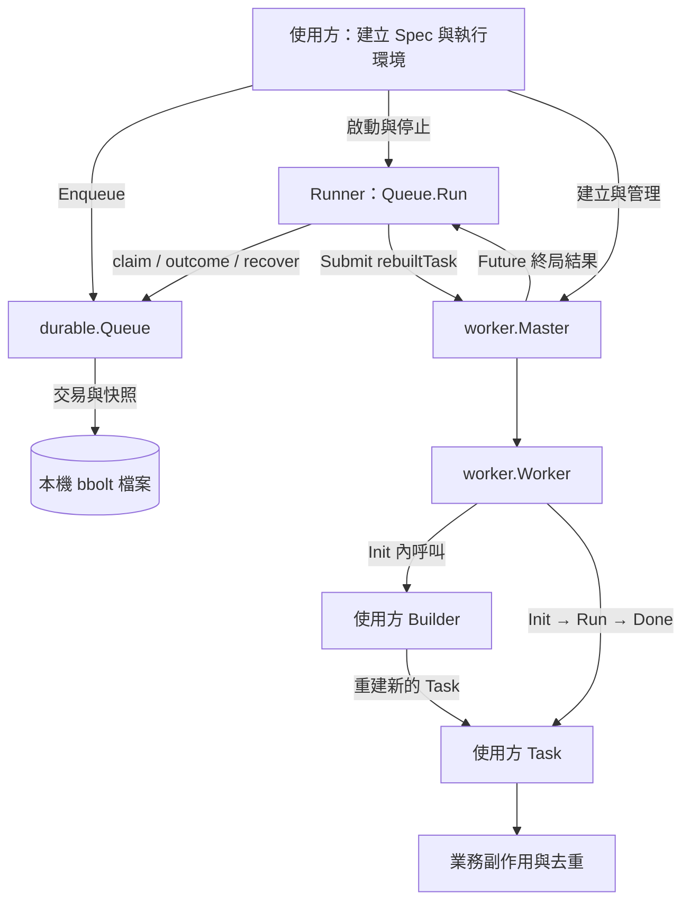
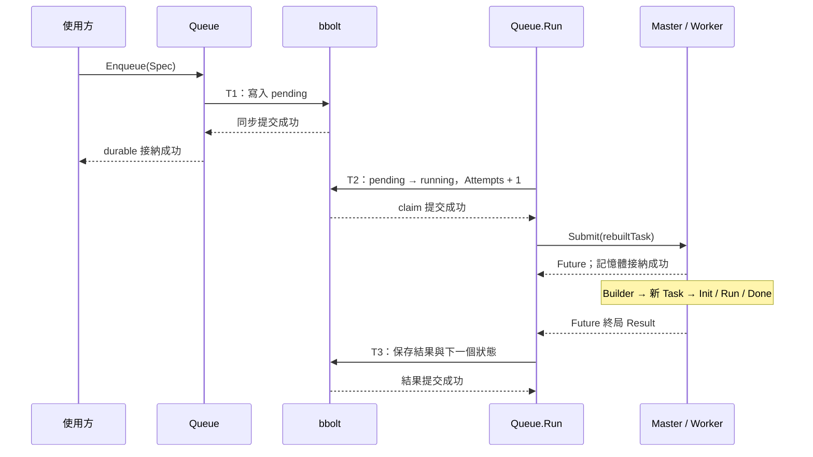
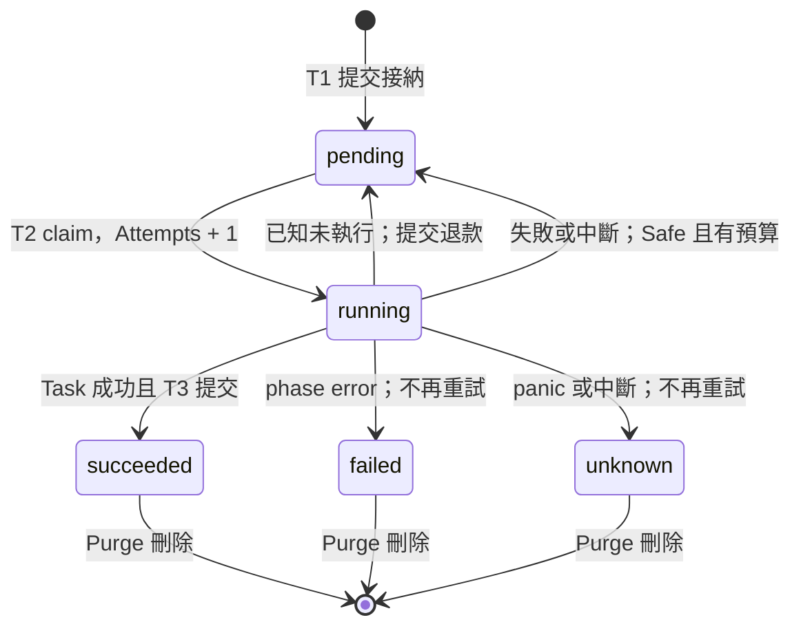

# Durable Storage 設計

`durable` 在記憶體內的 Master 前面加上一層持久化工作紀錄，讓「工作被接納」與「現在是否有 Worker 能執行」分開。
本文說明它的責任邊界、資料模型、交易、狀態轉移、失敗與恢復語意。

## 1. 目標與範圍

設計遵守四個條件：

1. 保存可重建的工作資料：獨立 JobID、Kind、資料版本、Payload，由使用方重建 Task。
2. 持久化提交成功才算接納。Master 派送被拒絕時，工作保留 pending。
3. 必要工作必須在 Task 成功返回前完成；完成狀態還必須另外提交到儲存。
4. 執行中斷留下不明結果；只有使用方明確宣告重複執行安全、且剩餘預算足夠，才自動重試。

範圍是**單程序、本機資料庫、一個資料庫擁有者、一個 Queue.Run**。
只持久化 Job，不保存 Task 物件、Master/Worker 狀態、goroutine、context 或執行到一半的 stack。
Task 的 Init、Run、Done 與 Builder 收到執行它的 Worker 的 context；
這個 context 只在 `Master.Stop`／`Worker.Stop` 或 Worker 結束時取消，不綁定 Runner 的 context。

## 2. 元件與責任

| 元件 | 責任 | 擁有者 |
| --- | --- | --- |
| 使用方 | 定義 payload、版本處理、Task 完成條件、業務冪等與去重 | 應用程式 |
| `durable.Queue` | 持久化接納、快照查詢、原子領取、結果與重試狀態、開啟時恢復與 schema 遷移、ready index、終局紀錄清除 | 呼叫 `Open` 的使用方 |
| `Queue.Run` | 有界派送、等待實際結果、保存結果、協調取消；可選擇在容量暫失時延後重試 | 使用方啟動與等待 |
| `Builder` | 從 Job 重建一個新的 Task；解讀 Kind、Version、Payload | 使用方 |
| `worker.Master` | 記憶體佇列、Worker 排程、容量與生命週期 | 使用方 |
| `worker.Worker` | 執行 Task phases，回報 phase error/panic/Goexit | Master |
| bbolt | 本機 key-value 交易、資料檔案、檔案鎖定 | Queue |

Runner 是 `Queue.Run` 的職責，沒有另外的公開 Runner 型別。
Master 必須設定正數 `WithQueueCapacity`；Master 自行建立與監督自己的 Worker。
Queue.Run 不會建立、關閉 Master，也不修改 Worker recovery policy。

依賴方向是 `應用程式 → durable → worker` 與 `durable → bbolt`；核心 worker 套件不依賴 durable。

## 3. 儲存後端：bbolt

bbolt 是嵌入 Go 程式的 key-value 資料庫，資料保存在本機檔案。
它提供交易與檔案鎖，同時只允許一個寫入交易、可有多個讀取交易，符合單一擁有者、原子領取的需求，
也避免自行設計日誌、原子更新與恢復格式。

開啟設定是 `0600` 檔案權限、取得檔案鎖最多等待一秒、正常同步提交。
不開放 NoSync，也不把 `*bolt.DB` 暴露給使用方。
持久化成功的邊界是同步交易提交成功；可靠性仍依賴檔案系統與裝置正確實作同步。

代價是寫入序列化、本機檔案的部署與備份責任，以及 Queue 與 bbolt 的直接耦合。
同一檔案不支援多個程序共同派送；複製資料庫成另一份可寫檔案，也不會形成協調或去重。

## 4. 資料模型

### 不可變的工作規格

| `Spec` 欄位 | 意義與規則 |
| --- | --- |
| `ID` | 獨立 JobID；空值會產生新隨機 ID。接納請求可能重送時，應由使用方提供穩定值 |
| `Kind` | 工作種類，必須非空；由 Builder 決定如何重建 |
| `Version` | Payload 的資料版本，必須大於零；由使用方負責相容與解碼 |
| `Payload` | 不透明 byte slice；Enqueue 會複製資料，儲存層不解讀業務內容 |
| `Retry` | 此工作的不可變重試規則 |

同一 JobID、相同正規化規格，Enqueue 回傳目前紀錄，包含已完成紀錄；不同規格回 `ErrConflict`。
Payload 依 byte 比較，內容等價但編碼不同的 JSON 視為不同規格。
JobID 識別持久化工作；業務識別碼可放在 Payload 作為外部去重鍵。
派送 wrapper 的 `ID()` 回傳 JobID，不呼叫使用方 Task 的 `ID()`。

### 可變執行紀錄

| `Job` 欄位 | 意義 |
| --- | --- |
| `State` | pending / running / succeeded / failed / unknown |
| `Attempts` | 已消耗的領取嘗試數；首次也計入；確定未執行的拒絕可退款 |
| `CreatedAt`、`UpdatedAt` | 建立與最後更新時間 |
| `NextAttemptAt` | 最早可再領取的時間 |
| `LastOutcome` | 最後一次結果：Phase、Error/Cause 文字、panic 文字與 stack、Interrupted 標記 |

Outcome 只保留診斷文字，不保存 error 型別、panic 物件或任意 Task 回傳資料。
成功重試會覆蓋 LastOutcome；不保留完整 attempt history。

### 實體格式

| Bucket | Key | Value |
| --- | --- | --- |
| `go-worker-durable-meta` | `schema-version` | 字串 `2` |
| `go-worker-durable-jobs` | JobID bytes | `encoding/json` 編碼的完整 Job |
| `go-worker-durable-ready` | 8 byte big-endian 就緒時間（UnixNano）+ JobID bytes | JobID bytes |

**ready index 恰好包含所有 pending 工作，每筆一個項目。**
就緒時間是 `NextAttemptAt`；未設定時使用使工作變成 pending 的那次 `UpdatedAt`。
所有寫入 Job 的路徑在同一交易內刪除舊 pending 項目、寫入新 pending 項目，再寫入 Job，
因此 index 與 Job 紀錄同時提交。Purge 只刪除本來就沒有 index 項目的終局 Job。

Job 直接以公開 struct 欄位序列化（Payload 為 base64，Retry.Delay 為整數奈秒），沒有獨立的儲存 DTO；
欄位改名、型別或編碼變更都是持久化格式變更。

### Schema 版本

**檔案 schema-version 與 Spec.Version 是兩個不同版本**：前者識別儲存格式，後者識別使用方的工作資料。

| 開啟時的 schema-version | Open 的處理 |
| --- | --- |
| 無（新檔案） | 建立三個 bucket，寫入 `2` |
| `1` | 在同一個初始化交易內建立 ready bucket，為每筆 pending 寫入 index，再改成 `2` |
| `2` | 要求 ready bucket 存在；缺少時回 `ErrSchema` |
| 其他 | 回 `ErrSchema`，不修改檔案 |

遷移單向且就地進行，失敗則整筆回滾；遷移後只支援版本 1 的程式會拒絕這個檔案。
讀取會驗證必要規格、嘗試範圍與合法狀態；claim 讀到損壞的 index 項目也回 `ErrSchema`。
這不等於驗證所有業務資料或所有可能的紀錄損壞。

## 5. 三個交易邊界

### T1：持久化接納

`Enqueue` 在一個寫入交易中完成「查 JobID → 比較已存在規格，或寫入 pending 與其 ready index」。
只有交易提交成功才回傳接納成功；這條路徑不需要 Master。
提交後、回覆送達前中斷，使用方以同一 JobID 查詢或重送相同規格；
提交回傳 I/O error 時，也不能推定磁碟上沒有該紀錄。已成功的提交不會改報成取消。

### T2：原子領取

`claim` 在一個寫入交易中讀取 ready index 的第一個項目。
就緒時間晚於現在表示沒有可領取的工作，交易回滾而不做空提交；
否則把對應 Job 改成 running、Attempts 加一、清空 NextAttemptAt，同時刪除 index 項目，再提交。
提交成功後 processor 才把 wrapper 交給 Master。

領取順序是就緒時間，同時間依 JobID；`concurrency` 大於一時，完成順序仍可能不同。
claim 透過寫入交易序列化，同一 pending 紀錄只會被一個 processor 領走。

**running 表示已領取嘗試**，它可能還在等待 Master queue 空位或 Worker handoff，
不能據此斷言 Task 已開始執行。程序在 claim 後中斷，恢復時會保守消耗這次嘗試。

### T3：結果與後續狀態

Runner 等待 Future 的真實終局結果，再於一個寫入交易保存：

- Task 成功：succeeded。
- Task phase error：failed，或依安全與預算規則直接保存 pending 及 NextAttemptAt。
- Panic/Goexit：unknown，或依同一規則直接保存 pending 及 NextAttemptAt。

結果、狀態與重試時間一起提交；不會先提交 failed 再以另一個交易改回 pending。
結果提交失敗會令 Run 回傳錯誤，殘留的 running 由下一次 Open 或 Run 恢復。
Task 執行與外部副作用都在儲存交易之外，不會在執行期間佔住寫入交易。

## 6. 狀態轉移與預算

succeeded、failed、unknown 是終局狀態，不會因重啟或相同 ID 再次 Enqueue 而重派。

`RetryPolicy.MaxAttempts` 包含首次，零預設為一；Delay 不得為負。
MaxAttempts 大於一時必須宣告 Safe。Safe 只表示使用方承諾冪等或去重，儲存層不替業務保證。
重試從一個新的 Task 的 Init 開始。

| 預算 | 控制對象 | 保存位置 |
| --- | --- | --- |
| `durable.RetryPolicy` + Job.Attempts | 同一 Job 最多可消耗多少嘗試，跨程序重啟保留 | Job 紀錄 |
| `worker.RecoveryPolicy` | 整個 pool 替換 panic Worker 的次數與滾動窗口 | Master 記憶體狀態 |

兩者獨立：Worker 替換成功不退還已執行的 Task 嘗試，Task phase error 也不消耗 Worker 替換預算。

### 確定未執行的判定

Submit 直接回 error 表示沒有接納 wrapper。
Submit 已接納、後來派送失敗的 Future 依核心 Result 合約分類：
`Err != nil && Phase == "" && Err != ErrWorkerPanic`。
核心執行 Task 方法時一定會設定 Phase，panic/Goexit 一律回 ErrWorkerPanic，所以這個分支是執行前拒絕：
提交 pending 與 Attempts 減一，再回傳派送錯誤。退款提交失敗時不能當成已回到 pending。
這是 durable 與核心 Result 分類的耦合點。

### 容量暫失時的延後重試

`WithDispatchRetry(delay)` 只改變執行前拒絕的後續處理，不改變退款規則。
派送錯誤以 `errors.Is` 符合下列之一時，視為 Master 暫時沒有 Worker：

| 錯誤 | 意義 |
| --- | --- |
| `worker.ErrRecoveryExhausted` | 沒有 Worker 在執行，且替換已達重啟上限 |
| `worker.ErrRecoveryFailed` | 沒有 Worker 在執行，且無法建立替換的 Worker |

這時退款交易同時把 NextAttemptAt 設為現在加 delay，processor 等待 delay 或 ctx 取消後再領取，Run 不返回。
Master 會在重啟上限的時間窗口允許時自行恢復 Worker，之後即可繼續派送。
其他派送錯誤（例如 `ErrMasterStopped`）與退款提交失敗仍會結束 Run；delay 必須為正數。
未使用這個選項時，上述錯誤會結束 Run，由使用方在 Master 恢復 Worker 後再啟動 Run。

## 7. 中斷點與恢復

Open 取得檔案鎖並初始化、驗證或遷移 schema 後，會把所有殘留 running 視為 interrupted；
每次 Run 開始前也做同一處理，涵蓋上一輪結果提交失敗的情況。
恢復在一個寫入交易內進行：Safe 且有剩餘預算則 pending 並寫入 ready index，其餘 unknown。
它不根據 Worker 的舊狀態推定有沒有副作用，也不增加嘗試數。

| 中斷／失敗位置 | 持久化狀態 | 處理 |
| --- | --- | --- |
| T1 寫入前取消 | 未接納 | 使用方可重新提出接納 |
| T1 提交中 I/O error | 不確定 | 以原 JobID 確認，不能假設未寫入 |
| T1 提交後、回覆前 | pending 或之後的狀態 | 同 JobID、同規格查詢或重送 |
| 接納後、claim 前 | pending | 之後可派送 |
| claim 後、Task 開始前 | running | 無法證明未執行，依 interrupted 規則處理 |
| Master 明確拒絕派送 | 退款後 pending | Run 回傳派送錯誤；啟用 `WithDispatchRetry` 且為容量暫失時延後重試 |
| Task 結果已保存 | failed／unknown，或可重試的 pending | 依已提交規則處理；不回滾外部副作用 |
| 副作用完成、T3 未提交 | running | 結果不明；可能重派已完成的工作 |
| T3 提交後 | succeeded | Runner 跳過；相同 Enqueue 不建立新工作 |
| 終局紀錄已被 Purge | 不存在 | 相同 JobID 再次 Enqueue 會建立新工作 |

**副作用完成與 durable 完成是兩個提交點**，兩者之間沒有共同交易。
使用方的去重必須與副作用具有所需的原子性；先寫或事後寫獨立標記，都可能形成另一個中斷空窗。

因此 durable 保證保存接納與已提交結果，並依明確規則安排有上限的重試；
不保證每個已接納工作最終成功，也不保證外部副作用 exactly-once。
甚至不保證至少執行一次：只有一個嘗試的工作若在 claim 提交後、Submit 前中斷，恢復時會成為 unknown，
可能連 Init 都沒有執行。unknown 會保留供使用方調查，沒有重開終局工作的 API。

### 終局紀錄清除

`Purge(ctx, cutoff, states...)` 在一個寫入交易內刪除指定終局狀態、且 `UpdatedAt` 早於 cutoff 的 Job。
states 只能是 succeeded、failed、unknown，且至少一個，否則回 `ErrInvalidPurge`；
因此 unknown 只有在明確列出時才會被刪除。
終局 Job 沒有 ready index 項目，Run 也不會修改終局 Job，所以 Purge 可在 Run 執行期間呼叫。

**Purge 同時刪除 JobID 的查重依據**：被刪除的 JobID 再次 Enqueue 會建立新工作，
接納請求可能重送的期間內不應清除對應紀錄。Purge 會掃描全部紀錄；bbolt 會重用釋放的頁面，但不縮小檔案。

## 8. Context、並行與關閉

Enqueue、Job、Jobs、Purge 的 context 在進入交易後與掃描期間檢查；
它無法打斷 bbolt 寫鎖等待或已開始的提交，所以不是儲存呼叫的硬性返回期限。

Run 的 context 只協調 processor 與 Master 的接納等待，不傳入 Builder 或 Task。
Submit 成功後以 `Future.Wait(context.Background())` 等真實結果，取消 Runner 不會放棄已接納工作。
任何 processor 遇到派送或儲存錯誤，會取消其他 processor 的新接納，再等待全部返回；
已領取但未被接納的工作會退款，已接納的工作仍取得結果並保存。
例外是 `WithDispatchRetry` 下的容量暫失：該 processor 等待後繼續，不取消其他 processor。

`concurrency` 限制領取到保存結果之間的工作數，與 Master queue capacity 是兩個不同上限。
沒有工作可領取時，processor 等待記憶體內的變更通知或 50ms timer；通知只是喚醒提示。

Run 釋放 running flag 前會等待所有 processor，因此在同步完成契約下，同一 JobID 的受管理 Task 嘗試
不會因取消 Runner 而重疊執行。這個保證不涵蓋 Task 自行留下的背景工作或遠端副作用。

擁有者的關閉順序是：取消並等待 Run、以 `Shutdown` 關閉自己擁有的 Master、最後 Close Queue。
Run 執行期間 Close 回 `ErrRunning`。改用 `Master.Stop` 會取消執行中 Task 的 context，
Task 因此回傳的錯誤照一般 phase error 保存。Task、Builder、diagnostic formatter 或 logger 不返回時，
都會延後等待；durable 不會強制終止它們。

## 9. 取捨與限制

| 設計點 | 現況與影響 |
| --- | --- |
| 儲存耦合 | Queue 直接持有 `*bolt.DB`，沒有可替換的 Store；使用 durable 就接受這個後端 |
| 層次責任 | Queue 同時承擔儲存、領取規則與 Runner 入口；容易使用，但替換後端不能只改 Open |
| 排程與效能 | claim 讀取 ready index；Open、Run 開始時的恢復、Jobs 與 Purge 仍讀取全部紀錄；沒有公平性或大規模吞吐保證 |
| 容量與留存 | 沒有紀錄數或 payload 大小上限；Purge 只依狀態與時間刪除，沒有自動 retention 或檔案 compaction |
| 不明結果處置 | unknown 可查詢但沒有 reconcile API；只自動重試事先宣告安全且有額度的工作 |
| 診斷資料 | 只有最新結果，沒有 attempt history 或型別化業務結果 |
| 相容與運維 | 只有 Open 時 v1 → v2 的單向遷移，沒有降版或備份恢復流程 |
| 時間來源 | NextAttemptAt 使用牆鐘時間，不保證在時鐘跳動時維持精確延遲 |

## 10. 替換儲存後端的條件

只提供本機 bbolt queue 時，保留具體實作可減少抽象與設定成本。
需要由使用方選擇儲存、或與既有業務資料共同提交時，才需要拆開持久化契約與 bbolt 實作。
替換後端至少要維持下列語意；只有 Get／Put 型的 CRUD 不足以表達原子領取與結果提交。

| 語意操作 | 必須維持的條件 |
| --- | --- |
| 接納／查重 | 同 JobID 規格衝突檢查與新紀錄寫入必須原子，成功回覆必須對應提交 |
| 領取到期工作 | 同一工作只能被一個有效擁有者領取，Attempts 與狀態同時更新 |
| 保存結果／重試決策 | Outcome、下一狀態與重試時間一起提交 |
| 確定未執行的退款 | Pending 與嘗試退款一起提交，不能退款其他執行嘗試 |
| 中斷恢復 | 先確立舊執行者不再擁有該工作，再套用結果不明的規則 |
| 查詢 | 回傳已提交的獨立快照，保持 JobID 與版本語意 |

介面應由消費儲存能力的 durable 一側定義，不外洩 `bolt.Tx`、bucket 或其他資料庫的交易型別。
多程序共用同一個 queue 另需 ownership、lease 或 fencing 設計，不能只把本機檔案鎖換成遠端 client。
